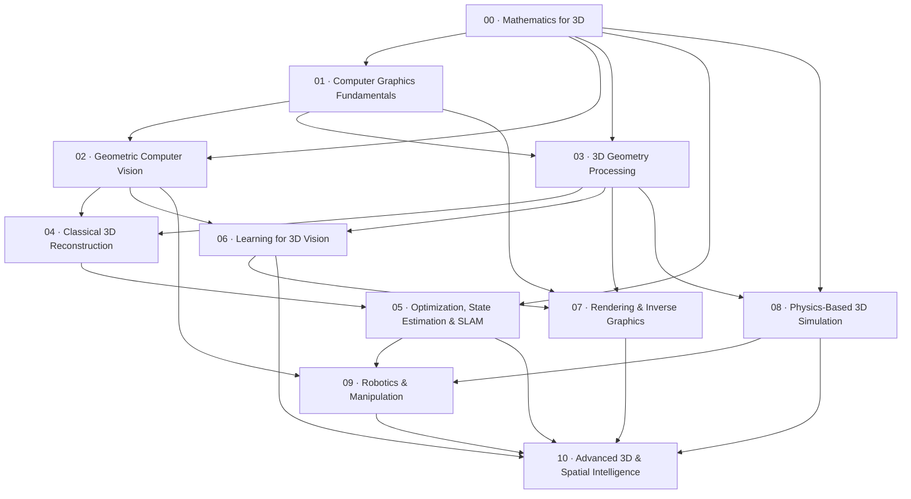

# 3D Vision · Module Learning Graph

An independent study sequence. Arrows mean prerequisite → module. Sources reviewed November 10, 2026.

## 00 · Mathematics for 3D

Main course: SE(3) · Lie groups · numerical optimization

Prerequisites: none

Implement and differentiate rigid transforms; solve and diagnose a geometric least-squares problem.

1. Vectors, matrices & coordinate frames
2. Python & numerical thinking
3. Calculus, probability & optimization
4. SVD, rank & numerical conditioning
5. Homogeneous points, lines & projective space
6. SO(3): rotations as a manifold
7. Lie algebra, hat operator & exponential map
8. SE(3), twists & rigid-body motion
9. Adjoints, perturbations & frame conventions
10. Jacobians & finite-difference checks
11. Gauss–Newton, damping & trust regions
12. Gaussian uncertainty & error propagation

Exit project: Build a transform library with SO(3)/SE(3) exponential maps, inverse/composition checks, and finite-difference Jacobian validation.

## 01 · Computer Graphics Fundamentals

Main course: CMU 15-462/662

Prerequisites: 00

Build a small rasterizer or ray tracer and explain each stage from scene to pixel.

1. Light, images & inverse problems
2. The pinhole camera
3. Sampling, aliasing & reconstruction filters
4. Triangles, barycentric coordinates & rasterization
5. Model, view, projection & clip space
6. Texture mapping & perspective-correct interpolation
7. Depth buffers, transparency & compositing
8. Rays, intersections & acceleration structures
9. Color, radiometry & linear-light operations
10. Interpolation, splines & time integration

Exit project: Render a textured triangle mesh with a camera, depth testing, antialiasing, and documented coordinate conventions.

## 02 · Geometric Computer Vision

Main course: CMU 16-822 + Stanford CS231A

Prerequisites: 00, 01

Estimate and validate a two-view camera relation, then triangulate reliable 3D points.

1. Calibration & distortion
2. Correspondence, descriptors & RANSAC
3. Epipolar geometry
4. Stereo, triangulation & depth
5. Projective transformations & invariants
6. Homography estimation & normalized DLT
7. Vanishing points & single-view metrology
8. PnP, pose & cheirality
9. The normalized eight-point algorithm
10. Rectification, degeneracy & model selection

Exit project: Implement normalized homography and fundamental-matrix estimation with RANSAC, pose disambiguation, and triangulation.

## 03 · 3D Geometry Processing

Main course: CMU 15-458/858 · Discrete Differential Geometry

Prerequisites: 00, 01

Build discrete surface operators and use them for smoothing, parameterization, or distance.

1. Points, voxels, meshes & implicit fields
2. Point-cloud learning & registration
3. Topology, manifolds & halfedge structures
4. Tangent spaces, normals & curvature
5. Exterior calculus & discrete differential forms
6. The cotangent Laplacian & mass matrix
7. Mean-curvature flow & implicit smoothing
8. Surface parameterization & conformal maps
9. Geodesics & distance on surfaces
10. Vector fields, connections & Hodge decomposition

Exit project: Load a triangle mesh, assemble cotangent and mass matrices, solve a Poisson problem, and visualize boundary effects.

## 04 · Classical 3D Reconstruction

Main course: CMU 16-822 · SfM / MVS

Prerequisites: 02, 03

Recover a scaled reconstruction from a carefully captured image sequence and diagnose failures.

1. Structure from motion & bundle adjustment
2. Dense reconstruction & surface fusion
3. Capture design, overlap & parallax
4. Match graphs & feature tracks
5. Two-view initialization & triangulation
6. Incremental registration & re-triangulation
7. Bundle-adjustment sparsity & Schur complement
8. Multi-view depth, cost volumes & consistency
9. TSDF fusion, meshing & visibility
10. Reconstruction benchmarks & failure diagnosis

Exit project: Reconstruct a real object; compare capture patterns, sparse/dense outputs, scale, reprojection error, and missing geometry.

## 05 · Optimization, State Estimation & SLAM

Main course: CMU 16-833 + public estimation references

Prerequisites: 00, 04

Construct a small pose graph and explain how uncertainty, gauge freedom, and loop closures affect the result.

1. Visual odometry, SLAM & uncertainty
2. Bayes filters & conditional independence
3. Kalman filtering & linear Gaussian systems
4. EKF, linearization & consistency
5. Particle filters & multimodal localization
6. Factor graphs & MAP estimation
7. Optimization on manifolds
8. Robust losses & data association
9. Loop closure, smoothing & incremental updates
10. Visual-inertial fusion, calibration & observability

Exit project: Optimize a noisy closed-loop trajectory, add an outlier loop, and compare plain least squares with robust estimation.

## 06 · Learning for 3D Vision

Main course: CMU 16-825

Prerequisites: 02, 03

Train or evaluate a geometric predictor using proper scene splits, scale conventions, and geometry metrics.

1. Deep learning for geometry
2. Objects, humans & 6D pose
3. Supervised & self-supervised depth
4. Single-view shape & occupancy learning
5. Neural SDFs & surface extraction
6. PointNet, neighborhoods & permutation symmetry
7. SO(3) equivariance & geometric features
8. 3D detection, segmentation & sparse encoders
9. Multi-view transformers & geometry conditioning
10. Losses, splits & 3D generalization

Exit project: Complete a 3D prediction assignment or evaluate an official pretrained model on a held-out scene type, including failure analysis.

## 07 · Rendering & Inverse Graphics

Main course: CMU 15-668 · PBRT · MIT 6.S980

Prerequisites: 01, 03, 06

Explain a Monte Carlo light-transport estimator and optimize scene parameters through rendering.

1. Rendering & differentiable rendering
2. NeRF & volume rendering
3. Gaussian splatting
4. Radiance, irradiance & the rendering equation
5. BRDFs, microfacets & material models
6. Monte Carlo estimators & importance sampling
7. Path tracing, direct lighting & variance
8. Participating media & transmittance
9. Inverse lighting, shape & material ambiguity
10. Relightable 3D & appearance disentanglement

Exit project: Compare a NeRF and Gaussian-splat scene on the same posed image split, then test geometric consistency and relighting limits.

## 08 · Physics-Based 3D Simulation

Main course: MIT Underactuated Robotics

Prerequisites: 00, 03

Simulate a mechanical system, evaluate numerical stability, and optimize a trajectory under its dynamics.

1. Configurations, velocities & equations of motion
2. The pendulum: energy, equilibria & phase space
3. Numerical integration & stability
4. Underactuation, controllability & linearization
5. Contact, friction & hybrid dynamics
6. LQR & local feedback design
7. Lyapunov functions & regions of attraction
8. Direct collocation & trajectory optimization
9. System identification & parameter uncertainty
10. Sim-to-real, domain randomization & validation

Exit project: Simulate a pendulum with multiple time integrators, identify its parameters from noisy observations, and design a stabilizing controller.

## 09 · Robotics & Manipulation

Main course: MIT Robotic Manipulation

Prerequisites: 02, 05, 08

Build a perception-to-pick pipeline in simulation with explicit frame conventions and uncertainty.

1. Spatial algebra & frame bookkeeping
2. Forward kinematics & Jacobians
3. Inverse kinematics & constraints
4. Perception for manipulation & registration
5. Grasp geometry, friction & force closure
6. Collision checking & motion planning
7. Impedance, force & feedback control
8. Scene segmentation, clutter & active perception
9. Imitation learning & learned manipulation policies
10. Perception-to-action capstone

Exit project: Estimate an object pose, generate grasp candidates, plan a collision-free approach, and evaluate success under pose noise.

## 10 · Advanced 3D & Spatial Intelligence

Main course: Neural SLAM · world models · physical 3D

Prerequisites: 05, 06, 07, 08, 09

Reproduce a bounded research result and distinguish geometric, visual, physical, and action-related evidence.

1. DUSt3R → MASt3R → VGGT
2. Generative 3D & inverse graphics
3. Dynamic scenes & 4D vision
4. 2026 frontier & reading research
5. Evaluation, robotics & your capstone
6. Neural implicit SLAM & map representations
7. Gaussian maps for online SLAM
8. World models: prediction, action & geometry
9. Physical 3D, object permanence & affordances
10. Research protocol, ablations & reproducibility

Exit project: Compare classical, learned, and generative representations on a defined spatial task, with a reproducible protocol and a failure log.

## Source collections

- [MIT 6.801 · Machine Vision](https://ocw.mit.edu/courses/6-801-machine-vision-fall-2020/)
- [Stanford CS231A · Geometry & Reconstruction](https://web.stanford.edu/class/cs231a/)
- [MIT 6.S980 · Machine Learning for Inverse Graphics](https://www.scenerepresentations.org/courses/2023/fall/inverse-graphics)
- [CMU 16-825 · Learning for 3D Vision](https://learning3d.github.io/)
- [PBRT · Physically Based Rendering, 4th edition](https://pbr-book.org/4ed/contents)
- [MIT · Underactuated Robotics](https://underactuated.mit.edu/)
- [MIT · Robotic Manipulation](https://manipulation.mit.edu/)
- [CMU 16-822 · Geometry-based Methods in Vision](https://geometric3d.github.io/)
- [CMU 15-458/858 · Discrete Differential Geometry](https://brickisland.net/DDGSpring2022/)
- [CMU 15-462/662 · Computer Graphics](https://15462.courses.cs.cmu.edu/fall2020/)
- [CMU 16-833 · Robot Localization and Mapping](https://www.cs.cmu.edu/~kaess/teaching/16833/Fall2024/)
- [Mathematics · Lie groups reference](https://ethaneade.com/lie.pdf)